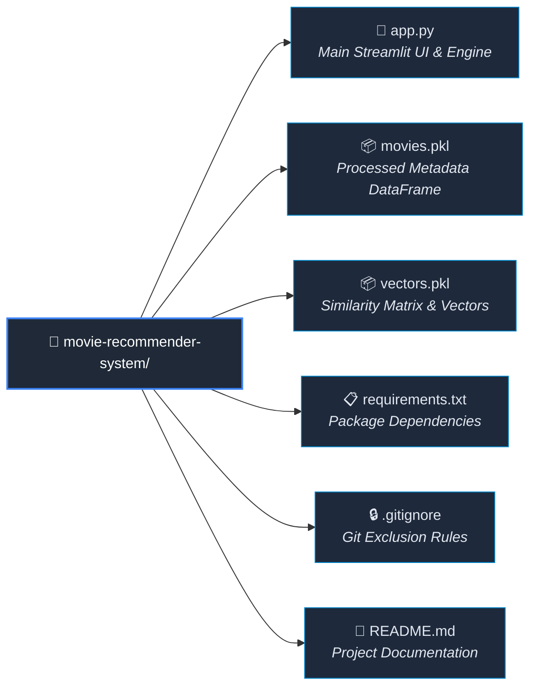

# 🎬 AI-Powered Movie Recommender System


An end-to-end, content-based Movie Recommendation Application built with Python, Scikit-Learn, and Streamlit. The system analyzes movie metadata—including genres, plot overviews, keywords, cast, and crew—to compute pairwise similarity vectors and deliver instant, highly relevant film recommendations along with dynamic posters fetched via the TMDB REST API.

🚀 **Live Web App:** [Movie Recommender System](https://movie-recommender-system-truf2a7wrsymemcbcfeymd.streamlit.app/)

---

## 📌 System Architecture

```text
┌────────────────┐     ┌───────────────────────┐     ┌───────────────────────┐
│ Raw TMDB Data  │ ──> │ Feature Engineering   │ ──> │ NLP Text Vectorization│
│ (Metadata/Cast)│     │ (Merge Genre/Overview)│     │ (Bag of Words / TFIDF)│
└────────────────┘     └───────────────────────┘     └───────────────────────┘
                                                                 │
                                                                 ▼
┌────────────────┐     ┌───────────────────────┐     ┌───────────────────────┐
│ Streamlit UI   │ <── │ Top-5 Matches         │ <── │ Cosine Similarity     │
│ (Posters + Meta)│     │ (Sorted Distance)     │     │ Matrix Calculation    │
└────────────────┘     └───────────────────────┘     └───────────────────────┘

```
## 📂 Project Directory Structure



git clone [https://github.com/Cosmic-Sangam/Movie-Recommender-System.git](https://github.com/Cosmic-Sangam/Movie-Recommender-System.git)
cd Movie-Recommender-System
